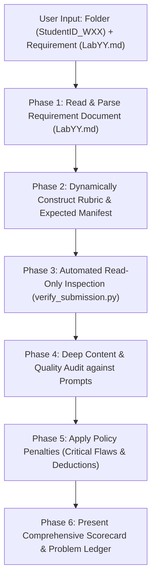

# Lab Assignment Compliance Auditor & Grader

> [!CAUTION]
> **STRICT READ-ONLY CONTRACT:**
> This skill is strictly an evaluator and auditor. It is **FORBIDDEN** from modifying, creating, moving, deleting, or renaming any student files. All file changes and packaging belong to `/lab-assignment` or the student.

This skill audits and grades lab assignment submissions according to `Policies.md` and the weekly requirement document (`LabYY...md`) for Computational Thinking (HCMUS FIT - Class 25A01 / CS252).

---

## Chat Input Trigger Format

When invoked, the user provides the path to the working folder, accompanied by the weekly requirement file:

```text
<working folder path: StudentID_WXX>
<path to weekly requirement Markdown file: LabYY...md>
```

*(Example:)*
```text
25125048_W01
Requirement/Lab01-Team Formation-Responsible AI Usage.md
```
*(Or natural language prompts:)*
```text
Check my lab work in 25125048_W01 against Requirement/Lab01-Team Formation-Responsible AI Usage.md
Grade my submission folder 25125048_W01
```

---

## Auditor Workflow



---

### Phase 1: Dynamic Requirement Re-Reading & Manifest Construction

> [!IMPORTANT]
> The auditor **MUST re-read the specific weekly exercise requirement document (`LabYY...md`)** before grading.

1. **Extract All Exercises**: Parse headings (e.g. `## Exercise 1 - Team Formation` through `## Exercise N`).
2. **Dynamically Build Expected Manifest**:
   - `StudentID_WXX/README.md` (Mandatory root file)
   - `StudentID_WXX/Git Commit Log.md` (Mandatory root file)
   - `StudentID_WXX/Exercise01/` through `StudentID_WXX/ExerciseYY/`
3. **Extract Explicit Questions & Sub-tasks**:
   - Identify prompt-specific requirements (e.g. member table with roles & strengths/weaknesses for Ex 1; 11 contract sections for Ex 2; novelty distinction for Ex 3; personal and group repos for Ex 4; reflection questions for Ex 5).
   - Identify expected deliverable types (Reporting: `.md` + companion `.pdf`; Coding: code + run instructions + screenshots).

---

### Phase 2: Automated Read-Only Folder Inspection

Run the verification script in read-only mode from the workspace root:

```powershell
python .agent/skills/check-lab-assignment/scripts/verify_submission.py "<path_to_StudentID_WXX>" -r "<path_to_LabYY.md>"
```

The script audits:
1. **Folder Naming**: Strictly matches `StudentID_WXX` (e.g. `25125048_W01`).
2. **Root Cleanliness & Critical Flaw Detection**:
   - Only `README.md` and `Git Commit Log.md` are permitted at root.
   - Any loose work files at root are flagged as **`CRIT-01` (Critical Flaw, $-2.00\text{ pts}$)**.
3. **Forbidden Artifacts**:
   - Zero tolerance for `node_modules/`, `bin/`, `obj/`, `.venv/`, `venv/`, `__pycache__/`, `.vs/`, `.idea/`, `.git/` (**`CRIT-02`, $-3.00\text{ pts}$**).
4. **Moodle File Limit**:
   - Total files $\le 20$. If $> 20$, output an informational advisory for Moodle (**no grading penalty**).
5. **Root Deliverables**:
   - `README.md` present (**`CRIT-03`**), AI Usage Declaration table present (**`MAJ-01`**), Academic Integrity Pledge present (**`MIN-02`**).
   - `Git Commit Log.md` present (**`CRIT-04`**), formatted via `--graph --all --stat` (**`MAJ-02`**), descriptive messages (**`MIN-01`**).
6. **Exercise Subdirectories & Deliverables**:
   - Dedicated `Exercise01/` ... `ExerciseYY/` folders matching exercise count.
   - Companion rendered `.pdf` file present alongside every `.md` report (exported via `yzane.markdown-pdf`). Missing companion PDF forfeits all deliverable points for that exercise.

---

### Phase 3: Qualitative Content Audit & Rubric Scoring

Score the submission out of **10.00 base points**:
- **Exercise Weight**: $W_i = \frac{10.0}{N}$ (e.g. $2.00\text{ pts}$ each for 5 exercises).
- **Sub-Criteria per Exercise**:
  - **Prompt Coverage (50%)**: Answers to all explicit questions extracted from `LabYY.md`.
  - **Deliverable Pairing (30%)**: Both `.md` and `.pdf` present (or code + instructions + screenshots).
  - **Depth, Rigor & Quality (20%)**: Detailed explanations, clean Markdown tables, independent thinking.

---

### Phase 4: Output Audit & Grading Report

Present the complete report using the following structure:

````markdown
# 📋 Lab Assignment Compliance & Grading Report

**Target Directory:** `<StudentID_WXX>`  
**Requirement File:** `<LabYY...md>`  
**Final Grade:** **X.XX / 10.00**  
**Compliance Status:** [ ✅ FULLY COMPLIANT | ⚠️ ACTION REQUIRED ]  
**Auditor Mode:** 🔒 READ-ONLY (No files were modified)  

---

## 1. Executive Scorecard

| Component / Exercise | Max Pts | Earned | Status | Findings / Deductions |
| :--- | :---: | :---: | :---: | :--- |
| **Exercise 01: <Title>** | 2.00 | 2.00 | ✅ Pass | All prompts answered; PDF companion verified |
| **Exercise 02: <Title>** | 2.00 | 1.40 | ⚠️ Partial | Missing companion PDF (`-0.60 pts`) |
| ... | ... | ... | ... | ... |
| *Content Subtotal* | *10.00* | *X.XX* | | |
| **Policy: AI Usage Declaration** | 0.00 | 0.00 | ✅ Pass | Complete table & pledge present |
| **Policy: Git Commit Log** | 0.00 | -0.50 | ⚠️ Minor | Generic commit message detected |
| **Policy: Folder Cleanliness** | 0.00 | 0.00 | ✅ Pass | No loose root files; zero forbidden artifacts |
| **FINAL SCORE** | **10.00** | **X.XX** | | |

---

## 2. Exhaustive Problem Ledger

### 🚨 Critical Flaws & Blockers
(Itemized entries with Location, Policy Clause, Impact, Details, and Fix instructions)

### ⚠️ Major Requirement Deficiencies
(Itemized entries with missing prompts, incomplete sections, or lack of depth)

### ℹ️ Minor Advisories & Quality Warnings
(Itemized entries with commit message quality, formatting, or Moodle upload notes)

---

## 3. Requirement Traceability Matrix (`LabYY`)
(Itemized table mapping every prompt and sub-task from the requirement document to submission evidence)

---

## 4. Remediation Action Plan (Next Steps for Student)
(Numbered checklist with concrete steps to resolve every identified issue and achieve 10.00 / 10.00)
````
