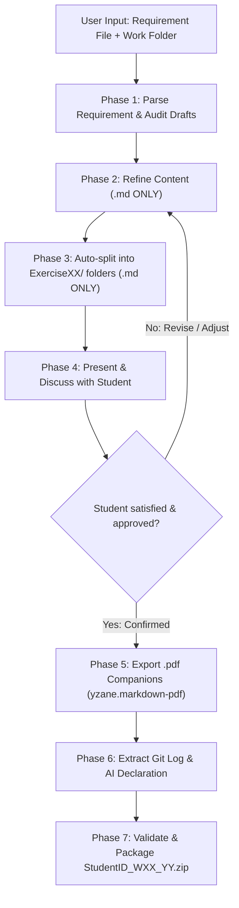

# Lab Assignment Assistant & Auto-Organizer

This skill implements the submission and refinement workflow defined in `Policies.md` for the Computational Thinking course (HCMUS FIT - Class 25A01 / CS252).

## Chat Input Trigger Format

When invoked, the user provides two path lines, optionally followed by custom notes or instructions:
```text
<file path for that week exercise>
<folderpath for tht week current work>
[Optional: notes or directives, e.g. "Exercise 3 has been completed, DO NOT MODIFY"]
```
*(Example:)*
```text
Requirement/Lab01-Team Formation-Responsible AI Usage.md
25125048_W01
Exercise 3 has been completed, DO NOT MODIFY.
```

---

## Two-Stage Workflow

The workflow is strictly divided into two distinct stages:
1. **Stage 1: Markdown Only & Discussion**: Refine and organize all work as `.md` files. Review and discuss with the student. **DO NOT** generate `.pdf` or `.zip` files yet.
2. **Stage 2: Finalize & Package (Upon Approval)**: Only after the student reviews, discusses, and explicitly confirms/approves the work, export `.pdf` companions using `yzane.markdown-pdf`, extract the Git commit log, and build the `.zip` archive.



---

## Stage 1: Drafting, Splitting & Discussion (Markdown ONLY)

### Phase 1: Input Parsing & Environment Discovery
1. **Extract Paths**:
   - Resolve `<file path for that week exercise>` (Requirement file).
   - Resolve `<folderpath for tht week current work>` (Student's work folder).
2. **Extract Metadata**:
   - **Student ID**: From folder name (e.g., `25125048_W01` $\rightarrow$ `25125048`), student files (`Git.md`), or git config.
   - **Week Number (`XX`)**: From folder name or requirement title (e.g., `W01` $\rightarrow$ `01`).
   - **Student Name & Repo**: Check `Git.md` or git log (e.g., `Lý Trần Thái`, `https://github.com/LyTranThai/Computational-Thinking`).
3. **Parse Requirement Specifications**:
   - Read the week's requirement file in full.
   - Enumerate all exercises (e.g., Exercise 1, Exercise 2, ... Exercise N).
   - Identify deliverables for each exercise.

### Phase 2: Content Audit & Refinement (Markdown ONLY)
1. **Audit Current Work & Check Freeze Directives**:
   - Inspect all existing files in the current work folder.
   - **Check for Freeze Directives**:
     - **In Chat**: Check if the user specified directives like *"Exercise 3 has been completed, DO NOT MODIFY"* or *"Do not edit Personal_Proposal.md"*.
     - **In Files**: Check if any file contains comments or tags such as `<!-- DO NOT MODIFY -->`, `<!-- COMPLETED -->`, `[COMPLETED - DO NOT MODIFY]`, or `# DO NOT MODIFY`.
     - **Strict Rule for Frozen Files**: If an exercise/file is marked as completed or DO NOT MODIFY, **DO NOT alter its contents in any way**. Simply preserve the file verbatim.
   - Map existing files to the corresponding exercises.
   - Identify incomplete files, blank drafts, missing answers, or weak sections in non-frozen exercises.
2. **Refine & Enhance (Non-Frozen Exercises Only)**:
   - **Preserve Truth**: Keep the student's authentic details, team members, repository links, ideas, and decisions intact.
   - **Complete Missing Sections**: Answer all prompts and rubric criteria in the requirement document thoroughly and comprehensively in Markdown.
   - **Academic Rigor**: Ensure professional phrasing, structured headings, markdown tables, code blocks, and clear formatting.
   - **For Coding Tasks**: Ensure code is clean, modular, commented, and execution instructions are provided.

### Phase 3: Auto-Splitting into Required Directory Hierarchy (Markdown ONLY)
According to `Policies.md`, the submission folder structure **MUST** be:

```text
StudentID_WXX/
├── README.md               # AI Usage Declaration, other relevant information
├── Exercise01/             # Exercise 1 Markdown file (.md)
├── Exercise02/             # Exercise 2 Markdown file (.md)
├── Exercise03/             # Exercise 3 Markdown file (.md)
...
└── ExerciseYY/             # Exercise YY Markdown file (.md)
```

1. Ensure the folder is named `StudentID_WXX` (e.g., `25125048_W01`).
2. Create dedicated subdirectories: `Exercise01/`, `Exercise02/`, etc., for every completed exercise.
3. **Route All Completed Exercises to Folders**:
   > [!IMPORTANT]
   > Even if an exercise or file is marked **"DO NOT MODIFY"**, the agent **MUST STILL place it into its corresponding `ExerciseXX/` directory**. "DO NOT MODIFY" means its text/content remains untouched, but folder organization is strictly required for every exercise.
   - `Exercise01/` $\leftarrow$ Exercise 1 files (e.g., `Exercise01_Team_Formation.md`)
   - `Exercise02/` $\leftarrow$ Exercise 2 files (e.g., `Exercise02_Team_Contract.md`)
   - `Exercise03/` $\leftarrow$ Exercise 3 files (e.g., `Exercise03_Individual_Proposal.md`, preserved verbatim if marked DO NOT MODIFY)
   - `Exercise04/` $\leftarrow$ Exercise 4 files (e.g., `Exercise04_Git.md`)
   - `Exercise05/` $\leftarrow$ Exercise 5 files (e.g., `Exercise05_Responsible_AI.md`)
4. Create/update root `README.md` with the AI Usage Declaration table.

### Phase 4: Present & Discuss with Student
> [!IMPORTANT]
> **STOP HERE IN STAGE 1.** Do NOT generate `.pdf` files or `.zip` archives at this point.
> Present the refined Markdown work to the student:
> - Summarize the changes and enhancements made to each exercise.
> - Highlight any specific decisions, technical details, or questions for discussion.
> - Await student feedback and make any requested revisions until the student confirms: *"Looks good, proceed to finalize"* or equivalent.

---

## Stage 2: Finalization & Packaging (Post-Discussion / Upon Approval)

Trigger this stage **ONLY** after the student has reviewed the Markdown files and agreed to finalize:

### Phase 5: PDF Export using `yzane.markdown-pdf`
`Policies.md` requires:
> *"Submit both of the Markdown file and a rendered version (.pdf / .html) that displays the Markdown file correctly and attractively."*

Export `.pdf` files for all Markdown reports across all `ExerciseXX/` folders using the `yzane.markdown-pdf` extension:

1. **How `yzane.markdown-pdf` is configured**:
   - Workspace settings are configured in `.vscode/settings.json`:
     - `"markdown-pdf.type": ["pdf"]`
     - `"markdown-pdf.executablePath": "C:\\Program Files (x86)\\Microsoft\\Edge\\Application\\msedge.exe"`
     - `"markdown-pdf.format": "A4"`
     - Clean margins and background styling enabled.
2. **Exporting to PDF**:
   - For each report Markdown file in `ExerciseXX/`:
     - Open the Markdown file in the editor and invoke **`Markdown PDF: Export (pdf)`** (Command Palette `Ctrl+Shift+P` $\rightarrow$ `Markdown PDF: Export (pdf)` or right-click in editor).
     - Alternatively, if `"markdown-pdf.convertOnSave": true` is enabled, saving the file triggers the export.
   - Ensure a corresponding `.pdf` file is generated alongside the `.md` file in each `ExerciseXX/` folder (including frozen exercises).

### Phase 6: Git Commit Log Extraction
1. Extract the git commit history for the week using:
   ```powershell
   git log --graph --all --stat --since="YYYY-MM-DD 00:00:00" --until="YYYY-MM-DD 23:59:59"
   ```
2. Save the output in `StudentID_WXX/Git Commit Log.md`.

### Phase 7: Automated Verification & Packaging
1. Run the packaging helper script:
   ```powershell
   python .agent/skills/lab-assignment/scripts/package_submission.py "<path_to_StudentID_WXX>"
   ```
2. The script will:
   - Verify folder naming `StudentID_WXX`.
   - Verify root files (`README.md`, `Git Commit Log.md`).
   - Verify each `ExerciseXX/` directory has both `.md` and `.pdf` files.
   - Verify no forbidden directories (`node_modules`, `bin`, `obj`, `.venv`, `__pycache__`, `.vs`) are included.
   - Compress the folder into `StudentID_WXX_YY.zip` where `YY` is the 2-digit exercise count (e.g., `25125048_W01_05.zip`).
   - Check Moodle limits: Max 20 files, Max 20 MB archive size.

### Phase 8: Final Submission Report
Present the completion report with:
- Summary of all files and folders created.
- Confirmation that each exercise has its `.md` and `.pdf` pair.
- Confirmation of zip archive location and size compliance.
